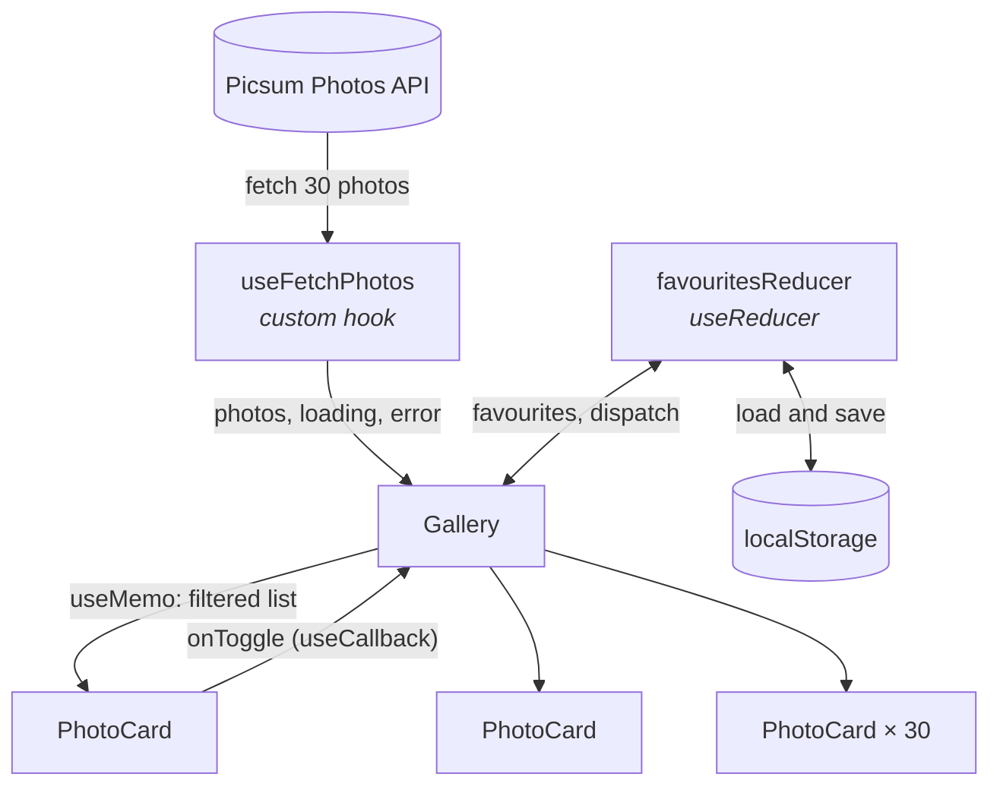
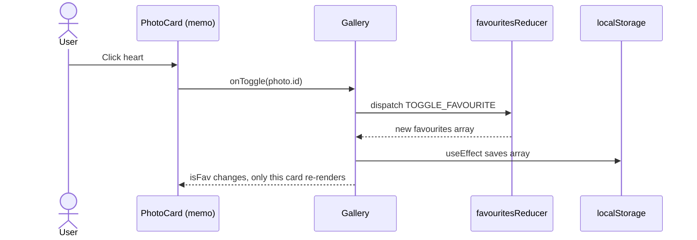

<div align="center">


[](https://github.com/bhavesh310/Photo-gallery-react)


<br>

**A polished, responsive photo gallery with glassmorphism UI, real-time search, and persistent favourites, built on core React fundamentals.**

[Features](#-features) · [Architecture](#-architecture) · [Getting Started](#-getting-started) · [Engineering Highlights](#-engineering-highlights) · [FAQ](#-faq)

<br>


</div>

---

## 📖 Table of Contents

- [Overview](#-overview)
- [Features](#-features)
- [Tech Stack](#-tech-stack)
- [Architecture](#-architecture)
- [Engineering Highlights](#-engineering-highlights)
- [Design System](#-design-system)
- [Project Structure](#-project-structure)
- [Getting Started](#-getting-started)
- [Responsive Design](#-responsive-design)
- [Accessibility](#-accessibility)
- [Testing Checklist](#-testing-checklist)
- [Deployment](#-deployment)
- [FAQ](#-faq)
- [Roadmap](#-roadmap)
- [Author](#-author)

---

## 🔭 Overview

**Photo Gallery** fetches 30 photos from the [Picsum Photos API](https://picsum.photos/), shows them in a responsive grid, filters them by author as you type, and lets you favourite photos that stay saved after a refresh.

The goal was to build a small app **properly**: clean separation of data logic and UI, predictable state with a reducer, deliberate performance choices, honest loading and error states, and a design that feels modern. It uses **Tailwind CSS only**, with no component libraries.

---

## ✨ Features

| | Feature | Details |
|---|---|---|
| 🖼️ | **Photo Grid** | 30 photos fetched on load from the Picsum API |
| ⏳ | **Loading State** | Animated orbit spinner, then shimmer placeholders per image |
| ⚠️ | **Error Handling** | Friendly error card if the request fails |
| 🔍 | **Live Search** | Filters by author name as you type, with no reload and no extra API call |
| ❤️ | **Favourites** | Animated heart toggle with a pop and ring pulse |
| 💾 | **Persistence** | Favourites survive refreshes through `localStorage` |
| 📱 | **Responsive** | 4 columns on desktop, 2 on tablet, 1 on mobile |
| 🎨 | **Modern UI** | Glassmorphism, aurora background, staggered entrance, 3D hover lift |
| 🌗 | **Light & Dark** | Follows the system colour scheme automatically |
| ♿ | **Accessible** | ARIA labels, focus rings, reduced-motion support |

---

## 🛠️ Tech Stack

| Layer | Technology | Purpose |
|---|---|---|
| UI | React 18 | Functional components and hooks only |
| Build | Vite 6 | Fast dev server and optimised builds |
| Styling | Tailwind CSS v4 | Utility-first styling, plus small custom CSS for animations |
| Data | Picsum Photos API | Free public photo source |
| Storage | `localStorage` | Persisting favourites |
| Tooling | Git + GitHub | Version control |

---

## 🧠 Architecture

### Component and data flow



### What happens when you click a heart



---

## 🏗️ Engineering Highlights

### 1. Custom hook: `useFetchPhotos`

Data fetching lives in its own hook, so `Gallery` never calls `fetch` directly.

```js
export default function useFetchPhotos() {
  const [photos, setPhotos] = useState([])
  const [loading, setLoading] = useState(true)
  const [error, setError] = useState(null)

  useEffect(() => {
    const controller = new AbortController()

    async function load() {
      try {
        const res = await fetch(URL, { signal: controller.signal })
        if (!res.ok) throw new Error(`Request failed (${res.status})`)
        setPhotos(await res.json())
      } catch (err) {
        if (err.name !== 'AbortError') setError(err.message || 'Something went wrong')
      } finally {
        if (!controller.signal.aborted) setLoading(false)
      }
    }

    load()
    return () => controller.abort()
  }, [])

  return { photos, loading, error }
}
```

- Returns `{ photos, loading, error }`.
- Non-OK responses are thrown so every failure reaches `catch`.
- `finally` always clears `loading`, so the spinner can't get stuck.
- `AbortController` cancels the request if the component unmounts.

### 2. Predictable state with `useReducer`

Favourites are an array of photo IDs, changed only through one action.

```js
export function favouritesReducer(state, action) {
  switch (action.type) {
    case 'TOGGLE_FAVOURITE':
      return state.includes(action.id)
        ? state.filter((id) => id !== action.id)
        : [...state, action.id]
    default:
      return state
  }
}
```

The initial state comes from `localStorage` through a **lazy initialiser** (`useReducer(reducer, [], initFavourites)`). It runs once, before the first render, wrapped in `try/catch` so missing or corrupted data safely falls back to `[]`.

### 3. Deliberate performance choices

| Tool | Applied to | Problem it solves |
|---|---|---|
| `useMemo` | Filtered photo list | The filter re-runs only when `photos` or `query` change, not on every heart toggle |
| `useCallback` | `handleSearch`, `handleToggle` | Keeps function identity stable between renders |
| `memo` | `PhotoCard` | Skips re-rendering unchanged cards. Toggling one heart re-renders **1 card instead of 30** |

`useCallback` and `memo` work as a pair: a stable function reference is what lets `memo` skip work.

<details>
<summary><b>Why not just <code>useState</code> for favourites?</b></summary>

<br>

A reducer puts every possible change to favourites in one function. That makes the logic easy to read, test and extend (for example a future "clear all" action) without touching any component.

</details>

<details>
<summary><b>What would break without these hooks?</b></summary>

<br>

Nothing visible, since there are only 30 photos. But the filter would recompute on every render and every card would re-render on every state change. The hooks are the right pattern and matter more as the list grows.

</details>

---

## 🎨 Design System

Colours, glass surfaces and animations are defined once in `src/index.css`.

| Element | Technique |
|---|---|
| Theme tokens | CSS variables (`--bg`, `--fg`, `--card`, `--a`, `--b`, `--c`) with a `prefers-color-scheme: dark` override |
| Aurora background | Three blurred colour orbs drifting slowly with a keyframe animation |
| Glass surfaces | Translucent background, border and `backdrop-filter: blur` |
| Hero title | Moving gradient text |
| Card entrance | Staggered `rise` animation, delayed by card index |
| Card hover | 3D lift, image zoom and a deepening gradient overlay |
| Heart | `pop` scale animation and an expanding ring pulse |
| Image loading | Shimmer skeleton, then a fade-in once loaded |
| Reduced motion | All animations shortened when the system requests it |

---

## 📂 Project Structure

```text
Photo-gallery-react/
│
├── index.html                      # App entry HTML
├── package.json                    # Dependencies and scripts
├── vite.config.js                  # Vite + React + Tailwind plugins
│
└── src/
    ├── main.jsx                    # React entry point
    ├── App.jsx                     # Layout, hero, animated background
    ├── index.css                   # Tailwind import, theme tokens, animations
    │
    ├── hooks/
    │   └── useFetchPhotos.js       # Custom data-fetching hook
    │
    ├── reducers/
    │   └── favouritesReducer.js    # Reducer + localStorage helpers
    │
    └── components/
        ├── Gallery.jsx             # Search, state wiring, grid, loading and error UI
        └── PhotoCard.jsx           # Photo card with favourite button
```

---

## 💻 Getting Started

### Prerequisites

- [Node.js](https://nodejs.org/) 18 or newer
- npm
- Git

### Installation

```bash
# Clone the repository
git clone https://github.com/bhavesh310/Photo-gallery-react.git

# Move into the project
cd Photo-gallery-react

# Install dependencies
npm install

# Start the dev server
npm run dev
```

Open the URL printed in the terminal, usually `http://localhost:5173`.

### Scripts

| Command | Description |
|---|---|
| `npm run dev` | Start the development server |
| `npm run build` | Create a production build in `dist/` |
| `npm run preview` | Preview the production build locally |

---

## 📱 Responsive Design

| Device | Breakpoint | Columns |
|---|---|---|
| 📱 Mobile | default | **1** |
| 📟 Tablet | `md` (≥ 768px) | **2** |
| 🖥️ Desktop | `lg` (≥ 1024px) | **4** |

The search bar stays pinned to the top while scrolling, on every screen size.

---

## ♿ Accessibility

- Search input and heart buttons have descriptive `aria-label`s
- Heart buttons expose their state with `aria-pressed`
- Loading and error states use `role="status"` and `role="alert"`
- Visible keyboard focus rings
- Animations reduce automatically with `prefers-reduced-motion`

---

## 🧪 Testing Checklist

- [ ] Spinner shows while photos load
- [ ] 30 photo cards render
- [ ] Error card appears when offline
- [ ] Search filters by author live, and clearing it restores everything
- [ ] Heart toggles on and off
- [ ] Favourites persist after a refresh
- [ ] Grid shows 4, 2 and 1 columns at different widths
- [ ] No errors in the browser console

---

## 🚀 Deployment

The app builds to static files:

```bash
npm run build
```

Deploy the generated `dist/` folder to **Vercel**, **Netlify** or **GitHub Pages**.

---

## ❓ FAQ

<details>
<summary><b>Why do so many photos have the same author?</b></summary>

<br>

The Picsum list endpoint returns 30 photos from only a handful of authors, so names repeat a lot. Searching a common author returns a big group. This comes from the API data, not from the filter.

</details>

<details>
<summary><b>Does searching call the API again?</b></summary>

<br>

No. Search filters the photos that were already fetched, using `useMemo`.

</details>

<details>
<summary><b>Where are favourites stored?</b></summary>

<br>

In your browser's `localStorage` under the key `gallery:favourites`, as an array of photo IDs. Clearing site data removes them.

</details>

<details>
<summary><b>Why no UI library?</b></summary>

<br>

To keep the project focused on React fundamentals. Every component is built from Tailwind utilities and a small amount of custom CSS.

</details>

---

## 🗺️ Roadmap

- [x] Responsive grid with loading and error states
- [x] Real-time author search
- [x] Favourites with `useReducer` and `localStorage`
- [x] Animated, themeable UI
- [ ] Filter to show only favourites
- [ ] Full-size photo preview modal
- [ ] Pagination or infinite scroll
- [ ] Unit tests with Vitest and React Testing Library

---

## 📄 License

This project is intended for **educational, learning and portfolio purposes**.

---

## 👨‍💻 Author

<div align="center">

### Bhavesh Ghatode

**Full Stack Developer | Competitive Programmer | AI & Web Development Enthusiast**

[](https://github.com/bhavesh310)
[](https://www.linkedin.com/in/bhavesh-kumar-4466a3276/)

<br>

⭐ **If you like this project, give it a star!** ⭐


</div>
